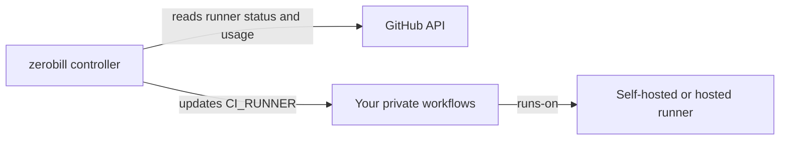

# zerobill

[](https://github.com/morhaf-ko/zerobill/actions/workflows/ci.yml)
[](https://github.com/morhaf-ko/zerobill/releases/latest)
[](LICENSE)

**Make your free GitHub Actions minutes last longer.**

zerobill prefers your self-hosted runner when it is usable, then shares available
GitHub and optional Blacksmith free minutes. Connect each private workflow with
one repository variable:

```yaml
runs-on: ${{ vars.CI_RUNNER }}
```

[Connect your first workflow](docs/getting-started.md) ·
[Run with Docker or systemd](docs/service.md) · [Configuration](docs/reference.md)

## How it works

Run one zerobill controller on a computer that stays on. It reads runner status
and usage from GitHub, then updates `CI_RUNNER` in the private repositories whose
workflows use that variable. GitHub Actions schedules jobs on the selected label.



Your own runner is optional. Without one, zerobill can balance GitHub and Blacksmith
allowances. With GitHub alone, it stops selecting hosted capacity at the reserve.
A laptop runner can stay out by using a different label. zerobill never provisions
runners or turns machines on.

Checks run every 5 minutes by default, configurable down to 1 minute. With
`run --apply`, zerobill also cancels and reruns eligible jobs stalled on an
unavailable self-hosted label. Already started or failed jobs are left alone.

## Try it

Install [Go](https://go.dev/doc/install) and the [GitHub CLI](https://cli.github.com/),
then run:

```sh
go install github.com/morhaf-ko/zerobill/cmd/zerobill@latest
zerobill version
gh auth login --hostname github.com
zerobill init
zerobill status
```

Init asks for your GitHub owner and optional providers. It creates a config with
commented defaults and preserves existing files. Status reports the account and
credential source, explains missing access, and prints repository-specific next
commands. Before connecting a workflow, an incomplete status is expected.

Follow the [getting started guide](docs/getting-started.md) to initialize
`CI_RUNNER`, connect one workflow and test a real job. Then preview decisions:

```sh
zerobill run
```

After reviewing the choices, stop preview with Ctrl+C and enable routing:

```sh
zerobill run --apply
```

Installing the CLI does not start a service. Keep that process running, or use the
[Docker Compose or native Linux service instructions](docs/service.md). Configure
and authenticate on that machine; a laptop command does not control a VPS instance.
Run only one applied controller per GitHub owner.

The first Blacksmith scan reads this month's job history and can take several
minutes. CLI status prints progress; the controller's first routing log appears
after the scan finishes. Preserve its state volume so later checks use the cache.

## Providers and access

| Provider | What you set up | What zerobill reads |
| --- | --- | --- |
| GitHub | Private-repository and billing access | GitHub's billing report |
| Self-hosted, optional | A GitHub Actions runner with your chosen label | GitHub runner status and queued jobs |
| Blacksmith, optional | The [Blacksmith GitHub App](https://www.blacksmith.sh/) | GitHub job labels and durations; usage is an estimate |

The credential order is `GITHUB_TOKEN`, then `GH_TOKEN`, then the stored GitHub CLI
login. An environment token overrides the account shown by `gh auth status`.
`zerobill status` prints the selected source and next steps when access fails.
Organization roles and available billing reports also matter; adding token scopes
alone cannot fix every access problem. See [token permissions](SECURITY.md).

Blacksmith needs its GitHub App, but zerobill uses no Blacksmith API key or CLI.
For your own machine, follow the [self-hosted runner guide](docs/homelab.md).

## Config and defaults

Only `owner` is required. Init writes your choices and comments out optional
defaults. Uncomment an option to change it:

```yaml
owner: your-org

# Optional label shared only by machines you want used automatically.
# self_hosted_label: home-ci

# Enable after installing the Blacksmith GitHub App.
# blacksmith: false

# reserve_percent: 10
# alert_remaining_percent: 20
# check_interval: 5m
# queue_timeout: 10m
# notify: https://ntfy.sh/your-topic
```

The [config example](examples/config.yaml) and [reference](docs/reference.md) explain
ranges and environment settings. Upgrading from v0.3.5 or earlier requires renaming
`runner` to `self_hosted_label`, or `ZEROBILL_RUNNER` to
`ZEROBILL_SELF_HOSTED_LABEL`. Old names fail with a migration message.

## Routing and spending protection

1. Prefer usable matching self-hosted capacity.
2. Otherwise select the hosted provider with the lowest fraction of its usable
   allowance consumed. With the default 10% reserve, an allowance of 2,000 minutes
   provides 1,800 usable minutes; 3,000 provides 2,700.
3. Stop selecting a tier at its reserve. When no hosted capacity remains, jobs wait
   on the self-hosted label or on reserved label `zerobill-wait` without self-hosting.

Returning self-hosted capacity bypasses the 15-minute hold between hosted choices.
An empty matching pool is initially assumed to create runners on demand: selecting
its label does not prove a machine is online. A queued job exceeding `queue_timeout`
marks that capacity unavailable. [Availability rules](docs/reference.md#how-a-runner-counts-as-down)
explain retry and warm-pool behavior.

Configure `notify` for routing-change messages and low-capacity warnings. The
default warning is at 20% of the full allowance remaining, ahead of the 10% reserve.
Both thresholds are configurable. [Alert details](docs/reference.md#config) include
restart deduplication and delivery behavior.

zerobill reduces paid overflow risk; it cannot guarantee zero charges. Usage may
lag, running jobs continue, fixed-label workflows bypass routing, and failed API
reads or a stopped controller leave the last variable values in place. Configure
provider spending limits separately. GitHub's budget must have
[Stop usage when budget limit is reached](https://docs.github.com/en/billing/how-tos/set-up-budgets)
enabled. zerobill does not verify provider limits or manage storage charges.

Blacksmith and self-hosted runners still depend on GitHub Actions scheduling.
Automatic hosted-provider outage detection is not implemented. See
[balancing and outages](docs/reference.md#hosted-balancing-and-outages) for manual
provider pauses and their limits.

## Documentation and support

| Guide | Use it to |
| --- | --- |
| [Getting started](docs/getting-started.md) | Connect one private repository and verify its first job |
| [Service setup](docs/service.md) | Run continuously, update, inspect logs and stop |
| [Self-hosted runners](docs/homelab.md) | Set up a runner or use an existing GARM/ARC pool |
| [Reference](docs/reference.md) | Look up config, permissions, routing and failure behavior |
| [Testing](docs/testing.md) | Test unreleased code and isolated provider scenarios |

Report reproducible bugs or suggest improvements through
[GitHub issues](https://github.com/morhaf-ko/zerobill/issues). Include your version
and sanitized diagnostics; keep credentials and private repository details out.
Report vulnerabilities through [private security reporting](SECURITY.md).

Contributions follow [CONTRIBUTING.md](CONTRIBUTING.md). The project is
[MIT licensed](LICENSE).
